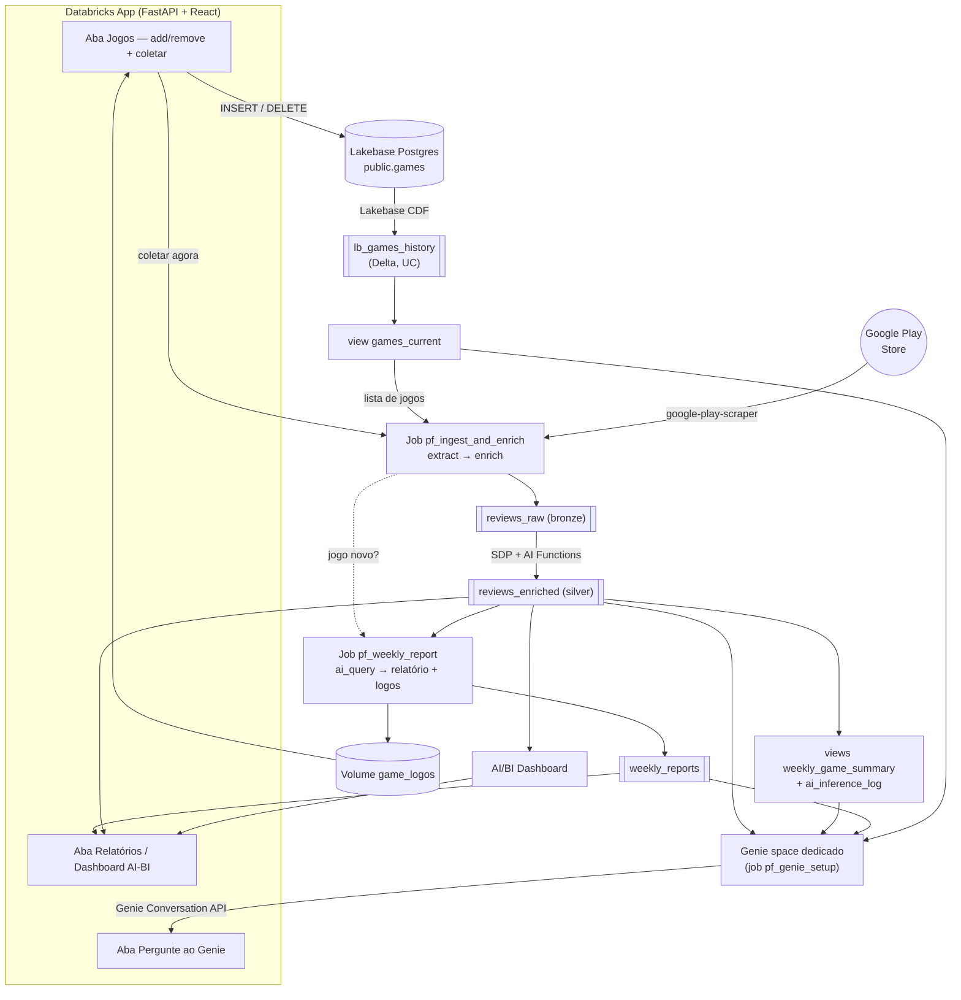

# Player Feedback Analysis

Demo Databricks que monitora reviews de **qualquer jogo** da Google Play Store: coleta os
comentários, enriquece com **AI Functions** (7 dimensões + sentimento), gera relatórios semanais
por jogo e serve tudo num **Databricks App** (dashboard **AI/BI** embeddado + chat **"Pergunte ao Genie"**
sobre um **Genie space dedicado**, via Genie Conversation API). Os jogos
monitorados são cadastrados **pela própria interface do App** — sem editar código. Tudo provisionado
via **Databricks Asset Bundles (DABs)**.

## 1. Arquitetura



- **Cadastro de jogos**: o App grava no **Lakebase** (Postgres). O **Lakebase CDF** materializa as
  mudanças na tabela Delta `lb_games_history`, da qual deriva a view `games_current` — a fonte de
  verdade lida pelos jobs. Ao clicar em "coletar agora", o App espera o CDF refletir o cadastro e
  então dispara **uma** execução do job de coleta.
- **Coleta + enriquecimento** (`pf_ingest_and_enrich`): extrai reviews (dedup/filtro na fonte;
  backfill por data para jogos novos), enriquece via SDP e, se houver jogo novo, dispara o relatório.
- **Relatório semanal + logos** (`pf_weekly_report`): `ai_query` gera o resumo por jogo e baixa os
  logos para o Volume. Roda no agendamento semanal e sob demanda (jogos novos).
- **Genie space** (`pf_genie_setup`): space dedicado sobre as tabelas governadas, definido como código
  (ver [Genie](#5-genie-space-e-chat-no-app)).
- **App**: relatórios por jogo, dashboard AI/BI embeddado, chat com o Genie space e a tela de gestão de jogos.

## 2. Estrutura do repositório

```
player_feedback/
├── databricks.yml            # bundle + variáveis + target dev
├── resources/                # segmentado por workflow, não por tipo de objeto
│   ├── pf_compute.yml         # SQL Warehouse serverless (2X-Small)
│   ├── pf_daily.yml           # setup + ingestão/enriquecimento (job + pipeline SDP)
│   ├── pf_weekly.yml          # relatório semanal + coleta de logos
│   ├── pf_genie.yml           # job pf_genie_setup (Genie space como código)
│   └── pf_frontend.yml        # AI/BI Dashboard + App (bindings/permissões do SP)
├── src/                      # notebooks (achatado)
│   ├── setup.py               # Lakebase Autoscaling+CDF, schema, volume, tabelas, view, grants
│   ├── extract_reviews.py     # coleta (lê games_current)
│   ├── enrich_reviews.py      # SDP (reviews_raw → reviews_enriched)
│   ├── weekly_report.py       # relatório semanal
│   ├── extract_logos.py       # logos → Volume
│   ├── setup_genie.py         # cria/atualiza o Genie space + CAN_RUN para o SP do App
│   ├── genie/player_feedback.geniespace.json  # definição do Genie space (serialized_space)
│   └── player_feedback.lvdash.json  # AI/BI Dashboard
└── app/                      # FastAPI (server/) + React/Vite (frontend/)
```

## 3. Deploy

Pré-requisito único: um **catálogo** no workspace (o `pf_setup` tenta criar `player_feedback_catalog`
best-effort; se não tiver permissão de metastore, crie-o antes ou ajuste a variável `catalog`).
`databricks.yml` traz `workspace.host` e `run_as.user_name` como placeholders (`<SEU_WORKSPACE>`,
`<seu.email@empresa.com>`) — substitua pelos dados do seu próprio workspace antes do deploy.
O warehouse serverless, jobs,
pipeline, dashboard, App e as permissões do SP (bindings) vêm no bundle; o **Lakebase Autoscaling**
(project/branch/endpoint/database + CDF) é provisionado pelo `pf_setup` via `w.postgres` — o tier
Autoscaling não tem recurso DAB e é o único que suporta o CDF.

```bash
# -p <profile> = seu profile da CLI
databricks bundle validate -t dev -p <profile>
databricks bundle deploy   -t dev -p <profile>

databricks bundle run pf_setup -t dev -p <profile>   # schema, volume, tabelas, Postgres, CDF, view, grants
databricks bundle run pf_app   -t dev -p <profile>   # sobe o App
```

Depois é só abrir o App → aba **Jogos** → adicionar um ou mais jogos → **Disparar coleta agora**.

## 4. Adicionar um jogo pelo App

Na aba **Jogos** do App:

1. Em **Adicionar jogos**, preencha o **nome** e o **ID da Play Store** de cada jogo (dá para
   adicionar vários de uma vez) e clique em **Salvar jogos**.
2. Clique em **Disparar coleta agora** — uma única execução coleta os reviews de todos os jogos
   cadastrados. Jogos novos fazem backfill dos últimos meses e geram o primeiro relatório semanal.

**O que é o ID e como encontrar:** é o identificador do app na Google Play (o *package name*), que
aparece na URL da página do jogo, no parâmetro `id`:

```
https://play.google.com/store/apps/details?id=com.king.candycrushsaga
                                               └──────────┬─────────┘
                                                    ID (package name)
```

Abra a página do jogo na Play Store (site ou app), copie o valor após `id=` e cole no campo de ID.

## 5. Genie space e chat no App

O projeto provisiona um **Genie space dedicado** — `Player Feedback — Genie` — e o App conversa com
ele pela **Genie Conversation API** (aba **Pergunte ao Genie**). O dashboard AI/BI continua numa aba
própria (**Dashboard AI/BI**), só como embed; ele não traz Genie embutido.

**Definição como código.** `src/genie/player_feedback.geniespace.json` é o `serialized_space`
(versão 2) versionado, com `__CATALOG__.__SCHEMA__` como placeholder:

- **Tabelas**: `reviews_enriched`, `weekly_game_summary`, `weekly_reports`, `games_current`,
  `ai_inference_log`.
- **Instruções** (PT-BR + EN): glossário do domínio, valores de `sentiment`
  (`positive`/`negative`/`neutral`/`mixed`), significado dos 7 rótulos, semanas ISO
  ("semana passada" = última `week_start` completa em `weekly_game_summary`), qual tabela usar
  (agregados semanais → `weekly_game_summary`; textos → `reviews_enriched`; semáforo →
  `weekly_reports`; erros de IA → `ai_inference_log`).
- **Perguntas de exemplo** e **SQLs confiáveis** (example question SQLs) para as principais.

**Provisionamento.** O job `pf_genie_setup` (`src/setup_genie.py`) é idempotente: procura o space
pelo título e atualiza, ou cria se não existir; depois concede **CAN_RUN** ao service principal do
App. Usamos um job em vez do recurso `genie_spaces` do bundle porque a API do Genie exige que as
tabelas **já existam** na criação, e elas só aparecem depois do `pf_setup` + primeira execução do
pipeline. O App encontra o space pelo título em runtime (`GENIE_SPACE_TITLE`; para fixar um space,
defina `GENIE_SPACE_ID`), então a ordem de deploy não cria dependência circular:

```bash
databricks bundle deploy -t dev -p <profile>
databricks bundle run pf_setup             -t dev -p <profile>
databricks bundle run pf_app               -t dev -p <profile>  # SP do App precisa existir antes dos grants
# cadastre jogos no App e dispare a coleta (ou: databricks bundle run pf_ingest_and_enrich)
databricks bundle run pf_genie_setup       -t dev -p <profile>  # cria/atualiza o space + CAN_RUN ao SP
```

Rode `pf_genie_setup` de novo sempre que editar o JSON da definição.

**Como o chat funciona.** `POST /api/genie/ask` inicia uma conversa (`start_conversation`) ou faz
follow-up na mesma (`create_message`), espera até ~25 s e, se o Genie ainda estiver processando,
o frontend continua via `GET /api/genie/conversations/{id}/messages/{id}`. A resposta traz o texto,
o **SQL gerado** (recolhível), a **tabela de resultados** (`get_message_attachment_query_result`) e
sugestões de follow-up.

**Perguntas de exemplo**

- Quais jogos tiveram mais bug reports na semana passada?
- Como evoluiu o sentimento negativo de cada jogo nas últimas 4 semanas?
- Qual a nota do último relatório semanal de cada jogo?
- Qual a taxa de erro das chamadas de IA por modelo?
- Qual a distribuição de sentimento por jogo?
- Qual jogo teve a maior taxa de toxicidade na semana passada?
- Quais são os temas mais citados nos reviews negativos de cada jogo?
- Mostre os 10 reviews mais recentes com bug report
- Which game had the lowest average score last week?
- Quais jogos estão sendo monitorados atualmente?
